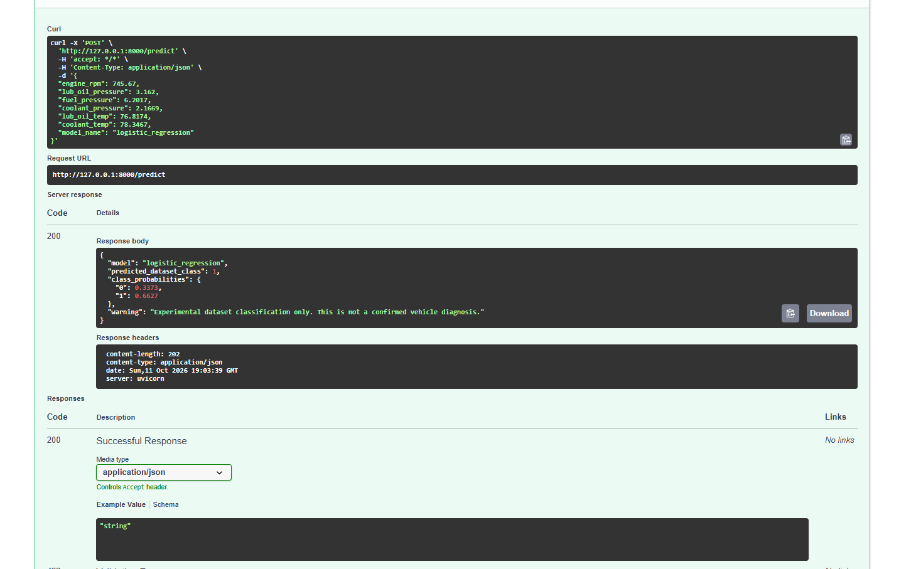
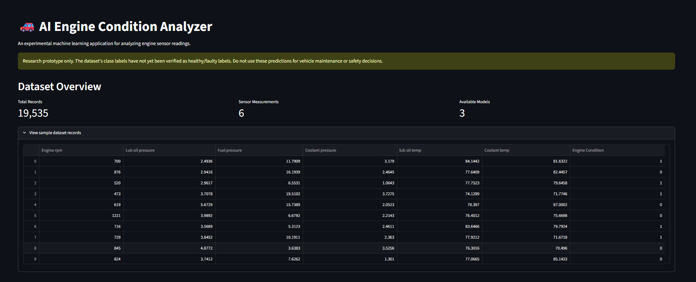
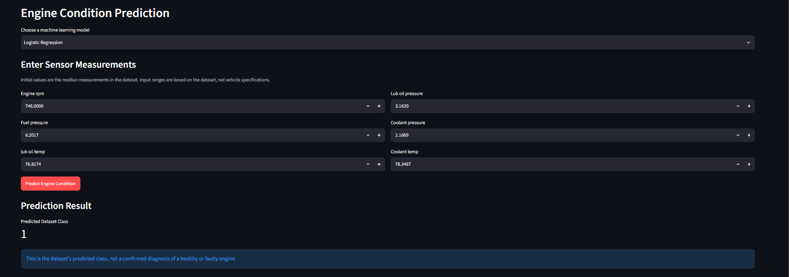

# AI-Powered Engine Condition Classification

## Overview

A machine learning application that analyzes engine sensor measurements
and predicts an engine-condition class using trained classification models.

This project demonstrates data exploration, machine learning,
model evaluation, feature importance, API development, and dashboard creation.

## Technologies

- Python
- Pandas and NumPy
- Scikit-learn
- Logistic Regression
- Random Forest
- Gradient Boosting
- Streamlit
- FastAPI
- Pytest

## Project Features

- Dataset exploration and quality checks
- Training and comparison of three ML models
- Feature importance visualization
- Interactive Streamlit dashboard
- FastAPI prediction endpoint
- Automated API tests

## Project Structure

```text
automotive-predictive-maintenance/
├── api.py
├── app.py
├── data/
├── models/
├── reports/
├── src/
│   ├── explore_data.py
│   ├── feature_analysis.py
│   └── train_model.py
├── tests/
│   └── test_api.py
├── requirements.txt
└── README.md

## API Testing

The FastAPI endpoint accepts engine sensor measurements
and returns a predicted dataset class with probability estimates.



**Endpoint:** `POST /predict`

**Successful response:** HTTP 200

> Note: This is an experimental dataset classification model,
> not a validated vehicle diagnostic system.

## Application Screenshots

### 1. Streamlit Dashboard

The dashboard allows users to enter engine sensor measurements and select a trained machine learning model.



### 2. Prediction Results

The application displays the predicted dataset class and model probability estimates.



### 3. FastAPI Prediction API

The API accepts engine sensor measurements and returns a prediction with probability estimates.


